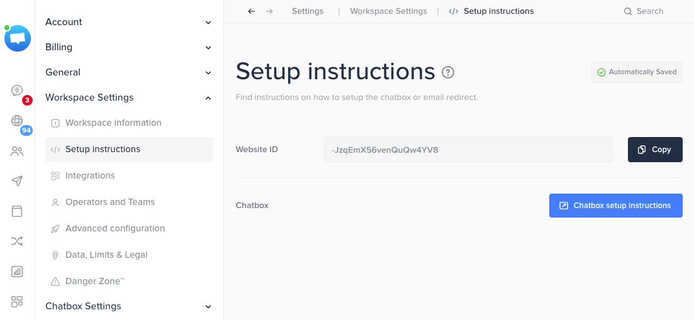

# Module Crisp SDK Android

Crisp Chatbox SDK for Android, used for visitors to get help from operators.

The chatbox is the Crisp Web widget, hosted in a WebView and wrapped in native Android components.

## Quickstart

Add the SDK to your dependencies, with the [latest version](https://central.sonatype.com/artifact/im.crisp/crisp-sdk):

```kotlin
dependencies {
    implementation("im.crisp:crisp-sdk:<version>")
}
```

Then present the chatbox, with the `websiteId` copied from your [Crisp Dashboard](https://app.crisp.chat/). 



There is nothing to initialize beforehand.

This minimal Compose sample presents both modal sheets: Compose [CrispBottomSheetModal][im.crisp.sdk.ui.CrispBottomSheetModal], and [CrispBottomSheetDialogFragment][im.crisp.sdk.ui.CrispBottomSheetDialogFragment] with the [CrispChat.show][im.crisp.sdk.ui.CrispChat.show] shortcut:

```kotlin
class MainActivity : FragmentActivity() {
    override fun onCreate(savedInstanceState: Bundle?) {
        super.onCreate(savedInstanceState)
        enableEdgeToEdge()
        setContent {
            AppTheme {
                App()
            }
        }
    }
}

@Composable
fun App() {
    val context = LocalContext.current
    var showCrispSheet by rememberSaveable { mutableStateOf(false) }

    Column(
        modifier = Modifier.fillMaxSize(),
        verticalArrangement = Arrangement.Center,
        horizontalAlignment = Alignment.CenterHorizontally
    ) {
        Button(onClick = { showCrispSheet = true }) {
            Text("Open Crisp in Compose Modal Sheet")
        }
        Button(onClick = {
            CrispChat.show(
                activity = context as FragmentActivity,
                websiteId = "YOUR_WEBSITE_ID"
            )
        }) {
            Text("Open Crisp in Fragment Modal Sheet")
        }
    }

    if (showCrispSheet) {
        CrispBottomSheetModal(
            websiteId = "YOUR_WEBSITE_ID",
            onDismissRequest = { showCrispSheet = false }
        )
    }
}
```

You can also embed the chatbox in your own layouts: see the [integration sample of each component][im.crisp.sdk.ui].

The [app module](https://github.com/crisp-im/crisp-sdk-android/tree/beta/app/src/main/java/im/crisp/catalog) is a test app trying these integrations.

To make the first chatbox show faster, you can call [Crisp.preheat][im.crisp.sdk.api.Crisp.preheat] early, e.g. from `Application.onCreate`.

### Audio recording and calls

The SDK declares no permission that needs the user's consent, so declare those of the features you want in your `AndroidManifest.xml`:

```xml
<manifest xmlns:android="http://schemas.android.com/apk/res/android">

    <!-- Audio recordings, and audio/video calls with your operators -->
    <uses-permission android:name="android.permission.RECORD_AUDIO" />
    <uses-permission android:name="android.permission.MODIFY_AUDIO_SETTINGS" />

    <!-- Video calls with your operators -->
    <uses-permission android:name="android.permission.CAMERA" />
    <!-- Otherwise declaring CAMERA hides your app from devices without camera on Google Play -->
    <uses-feature
        android:name="android.hardware.camera"
        android:required="false" />

</manifest>
```

The chatbox asks the user for them when needed, explaining why. Without them, these features are not available, and the SDK logs which permission is missing. Users can still send photos and videos taken with their camera app, which needs no permission, unless you declare `CAMERA`: Android then requires it, so the chatbox asks for it first.

## Coming from SDK 2.x

### The chatbox is configured where it is presented

SDK 2.x had a single chatbox, configured globally and presented by its own `Activity`:

```java
// In SDK 2.x
Crisp.configure(getApplicationContext(), "YOUR_WEBSITE_ID");

startActivity(new Intent(this, ChatActivity.class));
```

`Crisp.configure` and `ChatActivity` are gone. The chatbox is now a component that you place in your UI like any other, and it receives its `websiteId` and optional `tokenId` the way this UI toolkit passes them:

| Toolkit                  | Given by   | Sample                                                                                              |
|--------------------------|------------|-----------------------------------------------------------------------------------------------------|
| Compose                  | Parameters | `CrispChatbox(websiteId = "YOUR_WEBSITE_ID", tokenId = user.id)`                                    |
| View and Fragment in XML | Attributes | `app:crisp_sdk_website_id="@string/your_website_id"` and `app:crisp_sdk_token_id="@string/user_id"` |
| Fragment in code         | Arguments  | `CrispFragment.newInstance(websiteId = "YOUR_WEBSITE_ID", tokenId = user.id)`                       |
| View in code             | Method     | `chatboxView.load(CrispConfig(websiteId = "YOUR_WEBSITE_ID", tokenId = user.id))`                   |

There is no global state to keep up to date anymore: changing `Crisp.setTokenID` becomes passing another `tokenId`, and each chatbox can load its own website.

The multidex and `FileProvider` installation steps of SDK 2.x are no longer needed either.

### Crisp methods are split between two controllers

[Crisp][im.crisp.sdk.api.Crisp] only keeps what applies to the whole SDK: its [logs][im.crisp.sdk.api.CrispLogger], [version][im.crisp.sdk.api.Crisp.version] and [preheat][im.crisp.sdk.api.Crisp.preheat]. Other methods moved to one of two controllers, because they do not need the same thing:

- [CrispSessionController][im.crisp.sdk.api.CrispSessionController] **writes** the user and session data. It does not need a chatbox: calls are saved, survive the app being killed, and are dispatched to the next chatbox loading this session. Use it from anywhere, e.g. right after the user logs in.
- [CrispChatboxController][im.crisp.sdk.api.CrispChatboxController] **drives one running chatbox**: it reads its data, triggers its UI and notifies its events. All of this needs a Web client to answer, so calls wait until the chatbox is ready, and the controller follows the lifecycle of the chatbox.

A session is identified by its `websiteId` and `tokenId`, so create the [CrispSessionController][im.crisp.sdk.api.CrispSessionController] with the same values as the chatbox, otherwise calls wait for a chatbox loading the other session:

```kotlin
// E.g. once the user is logged in, no chatbox needed
val config = CrispConfig(websiteId = "YOUR_WEBSITE_ID", tokenId = user.id)
val sessionController = CrispSessionController(context, config)
sessionController.user.setEmail(user.email)
sessionController.session.setSegments(listOf("customer"))

// Later on, this chatbox gets them before it becomes ready
@Composable
fun Support(user: User) {
    val scope = rememberCoroutineScope()
    val chatboxController = rememberCrispChatboxController()

    CrispChatbox(
        websiteId = "YOUR_WEBSITE_ID",
        tokenId = user.id,
        controller = chatboxController
    )
    Button(onClick = { scope.launch { chatboxController.helpdesk.search() } }) {
        Text("Search our help center")
    }
}
```

### Method mapping

| SDK 2.x                                                                                    | SDK 3                                                                                                                                                                                                                                                                                                                                                                                 |
|--------------------------------------------------------------------------------------------|---------------------------------------------------------------------------------------------------------------------------------------------------------------------------------------------------------------------------------------------------------------------------------------------------------------------------------------------------------------------------------------|
| `Crisp.configure`, `Crisp.setTokenID`                                                      | `websiteId` and `tokenId` of the component, see above                                                                                                                                                                                                                                                                                                                                 |
| `Crisp.resetChatSession`                                                                   | [CrispSessionController.session.reset][im.crisp.sdk.api.CrispSessionController.Session.reset]                                                                                                                                                                                                                                                                                         |
| `Crisp.getSessionIdentifier`                                                               | [CrispChatboxController.session.getIdentifier][im.crisp.sdk.api.CrispChatboxController.Session.getIdentifier], or [CrispEventCallbacks.onSessionLoaded][im.crisp.sdk.api.CrispEventCallbacks.onSessionLoaded]                                                                                                                                                                         |
| `Crisp.setSessionBool`, `setSessionInt`, `setSessionString`                                | [CrispSessionController.session.setData][im.crisp.sdk.api.CrispSessionController.Session.setData]                                                                                                                                                                                                                                                                                     |
| `Crisp.setSessionSegment`, `setSessionSegments`                                            | [CrispSessionController.session.setSegments][im.crisp.sdk.api.CrispSessionController.Session.setSegments]                                                                                                                                                                                                                                                                             |
| `Crisp.pushSessionEvent`, `pushSessionEvents`                                              | [CrispSessionController.session.pushEvent][im.crisp.sdk.api.CrispSessionController.Session.pushEvent]                                                                                                                                                                                                                                                                                 |
| `Crisp.setUserAvatar`, `setUserEmail`, `setUserPhone`, `setUserCompany`, `setUserNickname` | [CrispSessionController.user.setAvatar][im.crisp.sdk.api.CrispSessionController.User.setAvatar], [setEmail][im.crisp.sdk.api.CrispSessionController.User.setEmail], [setPhone][im.crisp.sdk.api.CrispSessionController.User.setPhone], [setCompany][im.crisp.sdk.api.CrispSessionController.User.setCompany], [setNickname][im.crisp.sdk.api.CrispSessionController.User.setNickname] |
| `Crisp.runBotScenario`                                                                     | [CrispChatboxController.bot.runScenario][im.crisp.sdk.api.CrispChatboxController.Bot.runScenario]                                                                                                                                                                                                                                                                                     |
| `Crisp.searchHelpdesk`                                                                     | [CrispChatboxController.helpdesk.search][im.crisp.sdk.api.CrispChatboxController.Helpdesk.search]                                                                                                                                                                                                                                                                                     |
| `Crisp.openHelpdeskArticle`                                                                | [CrispChatboxController.helpdesk.openArticle][im.crisp.sdk.api.CrispChatboxController.Helpdesk.openArticle], whose `locale` now comes first                                                                                                                                                                                                                                           |
| `Crisp.showMessage`                                                                        | [CrispChatboxController.message.show][im.crisp.sdk.api.CrispChatboxController.Message.show]                                                                                                                                                                                                                                                                                           |
| `Crisp.addCallback`, `removeCallback`                                                      | [CrispChatboxController.addEventCallbacks][im.crisp.sdk.api.CrispChatboxController.addEventCallbacks], [removeEventCallbacks][im.crisp.sdk.api.CrispChatboxController.removeEventCallbacks]                                                                                                                                                                                           |
| `Crisp.addLogger`, `setLogLevel`                                                           | [Crisp.addLogger][im.crisp.sdk.api.Crisp.addLogger], [setLogLevel][im.crisp.sdk.api.Crisp.setLogLevel], now with a [CrispLogger][im.crisp.sdk.api.CrispLogger] and a `Log` priority                                                                                                                                                                                                   |
| `Crisp.getSDKVersion`                                                                      | [Crisp.version][im.crisp.sdk.api.Crisp.version]                                                                                                                                                                                                                                                                                                                                       |
| `Crisp.enableNotifications`, `CrispNotificationClient`                                     | [CrispNotifications][im.crisp.sdk.api.CrispNotifications] and [CrispNotificationService][im.crisp.sdk.api.CrispNotificationService], see Notifications below                                                                                                                                                                                                                          |

[CrispChatboxController][im.crisp.sdk.api.CrispChatboxController] also adds the getters of the user and session data, e.g. [user.getEmail][im.crisp.sdk.api.CrispChatboxController.User.getEmail] or [session.isOngoing][im.crisp.sdk.api.CrispChatboxController.Session.isOngoing].

### Sessions of SDK 1.0.15+ are restored once

When your users update your app, the session saved by SDK 1.0.15 and above is restored in the first chatbox loading its website, so that they find their conversation. It is then removed, so it is restored only once. Sessions saved by SDK 1.0.14 and below are never restored. Its notification settings are migrated (see Notifications below), then the other files of the previous SDK (its cache and the photos taken to be sent) are deleted.

It is only restored for a chatbox without `tokenId`, and only if no `tokenId` was set for its website in pre-3.x SDK:

- With a `tokenId`, the chatbox restores the session of the user on its own, as on the Web.
- If a `tokenId` was still set in pre-3.x SDK, a user was logged in, so their session is not shown to whoever uses the chatbox without `tokenId`. They will find it once logged in, except a conversation started before logging in, which is not kept either on the Web (see [session continuity](https://docs.crisp.chat/guides/chatbox-sdks/web-sdk/session-continuity/)).

Pre-3.x SDK did not tie a session to a `tokenId` though: unsetting it with `Crisp.setTokenID(null)` kept the session of the user, until `Crisp.resetChatSession` was called. So if your app logged users out without resetting the session, the restored session may be one of a user who was logged in. If a user is logged out when your app updates, [reset the session][im.crisp.sdk.api.CrispSessionController.Session.reset] before showing the chatbox, as you would on logout:

```kotlin
// E.g. on logout, or once after updating if logged out
CrispSessionController(context, CrispConfig(websiteId = "YOUR_WEBSITE_ID")).session.reset()
```

## Notifications

The chatbox notifies the user of the replies of your operators with [Firebase Cloud Messaging](https://firebase.google.com/docs/cloud-messaging/android/get-started), see [CrispNotifications][im.crisp.sdk.api.CrispNotifications].

1. Add Firebase to your app with `com.google.firebase:firebase-messaging` (25.1.2 or later, or BoM 34.18.0 or later). The SDK does not add it for you, not to force it on apps without notifications. The device is registered with its FCM registration token, or with its [Firebase installation ID](https://firebase.google.com/docs/cloud-messaging/android/client) if your app enables `firebase_messaging_installation_id_enabled`. The SDK follows the choice of your app.
2. Set up your Firebase project in your Crisp Dashboard, in `Settings > Chatbox Settings > Push Notifications`.
3. Declare the notification permission, which the chatbox asks for on Android 13 and later once the user sent a message:
   ```xml
   <uses-permission android:name="android.permission.POST_NOTIFICATIONS" />
   ```
4. Enable notifications for your website, e.g. from `Application.onCreate`:
   ```kotlin
   CrispNotifications.setEnabled(context, "YOUR_WEBSITE_ID", true)
   ```
5. Receive them, with [CrispNotificationService][im.crisp.sdk.api.CrispNotificationService] if Crisp is your only use of FCM, or from your own `FirebaseMessagingService`:
   ```kotlin
   override fun onMessageReceived(message: RemoteMessage) {
       if (CrispNotifications.isCrispNotification(message)) {
           CrispNotifications.handleNotification(this, message)
       } else {
           // Your notifications
       }
   }

   // With firebase_messaging_installation_id_enabled
   override fun onRegistered(installationId: String) {
       CrispNotifications.onRegistered(this, installationId)
   }

   // Without it
   override fun onNewToken(token: String) {
       CrispNotifications.onNewToken(this, token)
   }
   ```
6. That's it: tapping a notification opens the chatbox in a modal bottom sheet, above your launcher `Activity`. To show the chatbox component of your choice instead, pass `opensChatbox = false` to [handleNotification][im.crisp.sdk.api.CrispNotifications.handleNotification] (or override it in your [CrispNotificationService][im.crisp.sdk.api.CrispNotificationService]): the notification then only opens your launcher `Activity`, where [configFrom][im.crisp.sdk.api.CrispNotifications.configFrom] gives the chatbox to show:
   ```kotlin
   override fun onCreate(savedInstanceState: Bundle?) {
       super.onCreate(savedInstanceState)
       openCrispNotification(intent)
   }

   override fun onNewIntent(intent: Intent) {
       super.onNewIntent(intent)
       openCrispNotification(intent)
   }

   private fun openCrispNotification(intent: Intent) {
       CrispNotifications.configFrom(this, intent)?.let { config ->
           CrispChat.show(this, config.websiteId, config.tokenId)
       }
   }
   ```

Notifications are customized as Firebase ones, with the `com.google.firebase.messaging.default_notification_icon` and `default_notification_color` meta-data of your `AndroidManifest.xml` (by default, the Crisp icon and blue, in its light variant whatever the theme), and with the Crisp sound, which you can replace as in SDK 2.x by adding your own `res/raw/crisp_chat_message_receive` (any audio format, e.g. `.ogg`). Android only applies the sound when it creates the notification channel, so a sound changed afterwards only applies where the channel is created afterwards, e.g. on new installs.

They are shown in a notification channel per website, named "Crisp" by default. Name them in your `AndroidManifest.xml`, for all websites, or for one, with its website ID as is. As a string resource, the name is translated in the language of the user:

```xml
<application>
    <meta-data
        android:name="im.crisp.sdk.notification.channel.default"
        android:resource="@string/support_notification_channel" />
    <meta-data
        android:name="im.crisp.sdk.notification.channel.YOUR_WEBSITE_ID"
        android:value="Sales" />
</application>
```

Changing them later, or the language of the user, renames the channels, keeping the settings the user changed.

### Which session is notified

The device is notified of the replies to the session a chatbox last loaded for each website, once it is loaded. When a chatbox loads the website with another `tokenId` (e.g. another user logged in), the chatbox loads the previous session again for a moment first, to stop notifying the device of it, as Crisp only does so from the session itself. If it cannot be loaded in time (e.g. offline), its notifications are no longer shown, and the chatbox loads anyway. [Resetting the session][im.crisp.sdk.api.CrispSessionController.Session.reset] (e.g. on logout) stops showing its notifications right away, and stops notifying the device once a chatbox loads the website again.

So a notification only opens the session it was sent for if it is still the last one of its website: [configFrom][im.crisp.sdk.api.CrispNotifications.configFrom] returns the `websiteId` and `tokenId` the session was loaded with, never another session, so that the conversations of a user are not shown to another one using the same device.

If the session cannot be loaded anymore (its storage expired after about 6 months, or was cleared), the device stays registered on it for Crisp, but never shows its notifications. Loading it again by its session ID, then resetting it, would be cleaner, but is not worth a throwaway session for notifications that are not shown anyway.

The device is only registered for Crisp, or updated, while a chatbox is loaded, as only its connection can do it. So when the FCM registration token or the Firebase installation ID of the device changes (e.g. FCM rotates it, or your app switches to the installation ID), notifications sent meanwhile are lost, until a chatbox loads the website again and registers the new one.

### Coming from SDK 2.x

`Crisp.enableNotifications` becomes [CrispNotifications.setEnabled][im.crisp.sdk.api.CrispNotifications.setEnabled], which takes the website, and can be called at any time. `CrispNotificationClient` methods move to [CrispNotifications][im.crisp.sdk.api.CrispNotifications], and `CrispNotificationService` to `im.crisp.sdk.api`, so update its declaration in your `AndroidManifest.xml`. As there is no `ChatActivity` anymore, `CrispNotificationClient.openChatbox` becomes [configFrom][im.crisp.sdk.api.CrispNotifications.configFrom], to show your chatbox component with. `EventsCallback.onNotificationReceived` becomes a [CrispNotificationListener][im.crisp.sdk.api.CrispNotificationListener], registered with [CrispNotifications.addListener][im.crisp.sdk.api.CrispNotifications.addListener] (e.g. from `Application.onCreate`), with the same data.

Notification settings are migrated: websites with notifications enabled keep them, with their notification channel and the answer of the user to the prompt. If your app switches to the Firebase installation ID, the token registered by SDK 2.x is replaced by it on the session, once its chatbox loads.

## Events and logs

- [CrispEventCallbacks][im.crisp.sdk.api.CrispEventCallbacks] notifies you when a chatbox is opened or closed, when its session is loaded, and when a message is sent or received. Unlike the callbacks of SDK 2.x, they are registered per chatbox, on its controller.
- [CrispNotificationListener][im.crisp.sdk.api.CrispNotificationListener] notifies you when a notification is shown. It is global, as notifications are received while no chatbox is shown.
- [CrispLogger][im.crisp.sdk.api.CrispLogger] receives the logs of the SDK and its Web client instead of Logcat, for all chatboxes.

```kotlin
val controller = rememberCrispChatboxController(
    callbacks = CrispEventCallbacks(
        onMessageReceived = { message -> analytics.track("crisp_message_received") }
    )
)
```

```kotlin
class App : Application() {
    override fun onCreate() {
        super.onCreate()
        Crisp.addLogger { priority, tag, message -> crashReporter.log("$tag: $message") }
    }
}
```

Their own pages have more complete samples.

# Package im.crisp.sdk.api

Entry points and controllers to configure Crisp, drive a chatbox and set session or user data.

# Package im.crisp.sdk.model

Crisp models used by the API.

# Package im.crisp.sdk.ui

Embeddable chatbox components, for Jetpack Compose, Views and Fragments.

## Choosing a component

| Component                                                                        | Toolkit                        | Presentation                    |
|----------------------------------------------------------------------------------|--------------------------------|---------------------------------|
| [CrispBottomSheetModal][im.crisp.sdk.ui.CrispBottomSheetModal]                   | Compose                        | Modal bottom sheet              |
| [CrispChatbox][im.crisp.sdk.ui.CrispChatbox]                                     | Compose                        | In your layout                  |
| [CrispChat.show][im.crisp.sdk.ui.CrispChat.show]                                 | Any, with a `FragmentActivity` | Modal bottom sheet, in one call |
| [CrispBottomSheetDialogFragment][im.crisp.sdk.ui.CrispBottomSheetDialogFragment] | Fragment                       | Modal bottom sheet              |
| [CrispFragment][im.crisp.sdk.ui.CrispFragment]                                   | Fragment                       | In your layout, as a fragment   |
| [CrispChatboxView][im.crisp.sdk.ui.CrispChatboxView]                             | View                           | In your layout, as a view       |

The page of each component has its integration sample.

## What they share

- **Layout**: components embedded in your layout need to know how they are placed relative to the system bars, see [EdgeToEdge][im.crisp.sdk.ui.EdgeToEdge]. Modal bottom sheets handle it themselves.
- **Calls**: each component has a [CrispChatboxController][im.crisp.sdk.api.CrispChatboxController] to drive its chatbox. Which one to use depends on how long it must live, see its page.
- **Events**: [CrispEventCallbacks][im.crisp.sdk.api.CrispEventCallbacks] are registered on this controller.
