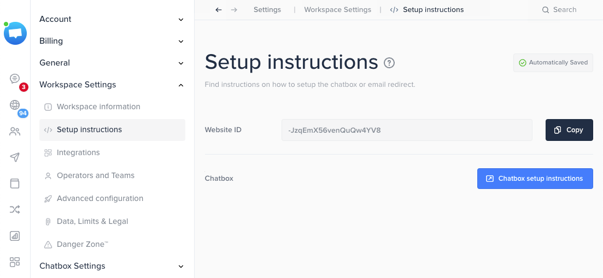

# Module Crisp SDK Android

Crisp Chatbox SDK for Android, used for visitors to get help from operators.

The chatbox is the Crisp Web widget, hosted in a WebView and wrapped in native Android components.

## Quickstart

Add the SDK to your dependencies, with the [latest version](https://central.sonatype.com/artifact/im.crisp/crisp-sdk):

```kotlin
dependencies {
    implementation("im.crisp:crisp-sdk:<version>")
}
```

Then present the chatbox, with the `websiteId` copied from your [Crisp Dashboard](https://app.crisp.chat/). 



There is nothing to initialize beforehand.

This minimal Compose sample presents both modal sheets: Compose [CrispBottomSheetModal][im.crisp.sdk.ui.CrispBottomSheetModal], and [CrispBottomSheetDialogFragment][im.crisp.sdk.ui.CrispBottomSheetDialogFragment] with the [CrispChat.show][im.crisp.sdk.ui.CrispChat.show] shortcut:

```kotlin
class MainActivity : FragmentActivity() {
    override fun onCreate(savedInstanceState: Bundle?) {
        super.onCreate(savedInstanceState)
        enableEdgeToEdge()
        setContent {
            AppTheme {
                App()
            }
        }
    }
}

@Composable
fun App() {
    val context = LocalContext.current
    var showCrispSheet by rememberSaveable { mutableStateOf(false) }

    Column(
        modifier = Modifier.fillMaxSize(),
        verticalArrangement = Arrangement.Center,
        horizontalAlignment = Alignment.CenterHorizontally
    ) {
        Button(onClick = { showCrispSheet = true }) {
            Text("Open Crisp in Compose Modal Sheet")
        }
        Button(onClick = {
            CrispChat.show(
                activity = context as FragmentActivity,
                websiteId = "YOUR_WEBSITE_ID"
            )
        }) {
            Text("Open Crisp in Fragment Modal Sheet")
        }
    }

    if (showCrispSheet) {
        CrispBottomSheetModal(
            websiteId = "YOUR_WEBSITE_ID",
            onDismissRequest = { showCrispSheet = false }
        )
    }
}
```

You can also embed the chatbox in your own layouts: see the [integration sample of each component][im.crisp.sdk.ui].

The [app module](https://github.com/crisp-im/crisp-sdk-android/tree/beta/app/src/main/java/im/crisp/catalog) is a test app trying these integrations.

To make the first chatbox show faster, you can call [Crisp.preheat][im.crisp.sdk.api.Crisp.preheat] early, e.g. from `Application.onCreate`.

### Audio recording and calls

The SDK declares no permission that needs the user's consent, so declare those of the features you want in your `AndroidManifest.xml`:

```xml
<manifest xmlns:android="http://schemas.android.com/apk/res/android">

    <!-- Audio recordings, and audio/video calls with your operators -->
    <uses-permission android:name="android.permission.RECORD_AUDIO" />
    <uses-permission android:name="android.permission.MODIFY_AUDIO_SETTINGS" />

    <!-- Video calls with your operators -->
    <uses-permission android:name="android.permission.CAMERA" />
    <!-- Otherwise declaring CAMERA hides your app from devices without camera on Google Play -->
    <uses-feature
        android:name="android.hardware.camera"
        android:required="false" />

</manifest>
```

The chatbox asks the user for them when needed, explaining why. Without them, these features are not available, and the SDK logs which permission is missing. Users can still send photos and videos taken with their camera app, which needs no permission, unless you declare `CAMERA`: Android then requires it, so the chatbox asks for it first.

## Coming from SDK 2.x

### The chatbox is configured where it is presented

SDK 2.x had a single chatbox, configured globally and presented by its own `Activity`:

```java
// In SDK 2.x
Crisp.configure(getApplicationContext(), "YOUR_WEBSITE_ID");

startActivity(new Intent(this, ChatActivity.class));
```

`Crisp.configure` and `ChatActivity` are gone. The chatbox is now a component that you place in your UI like any other, and it receives its `websiteId` and optional `tokenId` the way this UI toolkit passes them:

| Toolkit                  | Given by   | Sample                                                                                              |
|--------------------------|------------|-----------------------------------------------------------------------------------------------------|
| Compose                  | Parameters | `CrispChatbox(websiteId = "YOUR_WEBSITE_ID", tokenId = user.id)`                                    |
| View and Fragment in XML | Attributes | `app:crisp_sdk_website_id="@string/your_website_id"` and `app:crisp_sdk_token_id="@string/user_id"` |
| Fragment in code         | Arguments  | `CrispFragment.newInstance(websiteId = "YOUR_WEBSITE_ID", tokenId = user.id)`                       |
| View in code             | Method     | `chatboxView.load(CrispConfig(websiteId = "YOUR_WEBSITE_ID", tokenId = user.id))`                   |

There is no global state to keep up to date anymore: changing `Crisp.setTokenID` becomes passing another `tokenId`, and each chatbox can load its own website.

The multidex and `FileProvider` installation steps of SDK 2.x are no longer needed either.

### Crisp methods are split between two controllers

[Crisp][im.crisp.sdk.api.Crisp] only keeps what applies to the whole SDK: its [logs][im.crisp.sdk.api.CrispLogger], [version][im.crisp.sdk.api.Crisp.version] and [preheat][im.crisp.sdk.api.Crisp.preheat]. Other methods moved to one of two controllers, because they do not need the same thing:

- [CrispSessionController][im.crisp.sdk.api.CrispSessionController] **writes** the user and session data. It does not need a chatbox: calls are saved, survive the app being killed, and are dispatched to the next chatbox loading this session. Use it from anywhere, e.g. right after the user logs in.
- [CrispChatboxController][im.crisp.sdk.api.CrispChatboxController] **drives one running chatbox**: it reads its data, triggers its UI and notifies its events. All of this needs a Web client to answer, so calls wait until the chatbox is ready, and the controller follows the lifecycle of the chatbox.

A session is identified by its `websiteId` and `tokenId`, so create the [CrispSessionController][im.crisp.sdk.api.CrispSessionController] with the same values as the chatbox, otherwise calls wait for a chatbox loading the other session:

```kotlin
// E.g. once the user is logged in, no chatbox needed
val config = CrispConfig(websiteId = "YOUR_WEBSITE_ID", tokenId = user.id)
val sessionController = CrispSessionController(context, config)
sessionController.user.setEmail(user.email)
sessionController.session.setSegments(listOf("customer"))

// Later on, this chatbox gets them before it becomes ready
@Composable
fun Support(user: User) {
    val scope = rememberCoroutineScope()
    val chatboxController = rememberCrispChatboxController()

    CrispChatbox(
        websiteId = "YOUR_WEBSITE_ID",
        tokenId = user.id,
        controller = chatboxController
    )
    Button(onClick = { scope.launch { chatboxController.helpdesk.search() } }) {
        Text("Search our help center")
    }
}
```

### Method mapping

| SDK 2.x                                                                                    | SDK 3                                                                                                                                                                                                                                                                                                                                                                                 |
|--------------------------------------------------------------------------------------------|---------------------------------------------------------------------------------------------------------------------------------------------------------------------------------------------------------------------------------------------------------------------------------------------------------------------------------------------------------------------------------------|
| `Crisp.configure`, `Crisp.setTokenID`                                                      | `websiteId` and `tokenId` of the component, see above                                                                                                                                                                                                                                                                                                                                 |
| `Crisp.resetChatSession`                                                                   | [CrispSessionController.session.reset][im.crisp.sdk.api.CrispSessionController.Session.reset]                                                                                                                                                                                                                                                                                         |
| `Crisp.getSessionIdentifier`                                                               | [CrispChatboxController.session.getIdentifier][im.crisp.sdk.api.CrispChatboxController.Session.getIdentifier], or [CrispEventCallbacks.onSessionLoaded][im.crisp.sdk.api.CrispEventCallbacks.onSessionLoaded]                                                                                                                                                                         |
| `Crisp.setSessionBool`, `setSessionInt`, `setSessionString`                                | [CrispSessionController.session.setData][im.crisp.sdk.api.CrispSessionController.Session.setData]                                                                                                                                                                                                                                                                                     |
| `Crisp.setSessionSegment`, `setSessionSegments`                                            | [CrispSessionController.session.setSegments][im.crisp.sdk.api.CrispSessionController.Session.setSegments]                                                                                                                                                                                                                                                                             |
| `Crisp.pushSessionEvent`, `pushSessionEvents`                                              | [CrispSessionController.session.pushEvent][im.crisp.sdk.api.CrispSessionController.Session.pushEvent]                                                                                                                                                                                                                                                                                 |
| `Crisp.setUserAvatar`, `setUserEmail`, `setUserPhone`, `setUserCompany`, `setUserNickname` | [CrispSessionController.user.setAvatar][im.crisp.sdk.api.CrispSessionController.User.setAvatar], [setEmail][im.crisp.sdk.api.CrispSessionController.User.setEmail], [setPhone][im.crisp.sdk.api.CrispSessionController.User.setPhone], [setCompany][im.crisp.sdk.api.CrispSessionController.User.setCompany], [setNickname][im.crisp.sdk.api.CrispSessionController.User.setNickname] |
| `Crisp.runBotScenario`                                                                     | [CrispChatboxController.bot.runScenario][im.crisp.sdk.api.CrispChatboxController.Bot.runScenario]                                                                                                                                                                                                                                                                                     |
| `Crisp.searchHelpdesk`                                                                     | [CrispChatboxController.helpdesk.search][im.crisp.sdk.api.CrispChatboxController.Helpdesk.search]                                                                                                                                                                                                                                                                                     |
| `Crisp.openHelpdeskArticle`                                                                | [CrispChatboxController.helpdesk.openArticle][im.crisp.sdk.api.CrispChatboxController.Helpdesk.openArticle], whose `locale` now comes first                                                                                                                                                                                                                                           |
| `Crisp.showMessage`                                                                        | [CrispChatboxController.message.show][im.crisp.sdk.api.CrispChatboxController.Message.show]                                                                                                                                                                                                                                                                                           |
| `Crisp.addCallback`, `removeCallback`                                                      | [CrispChatboxController.addEventCallbacks][im.crisp.sdk.api.CrispChatboxController.addEventCallbacks], [removeEventCallbacks][im.crisp.sdk.api.CrispChatboxController.removeEventCallbacks]                                                                                                                                                                                           |
| `Crisp.addLogger`, `setLogLevel`                                                           | [Crisp.addLogger][im.crisp.sdk.api.Crisp.addLogger], [setLogLevel][im.crisp.sdk.api.Crisp.setLogLevel], now with a [CrispLogger][im.crisp.sdk.api.CrispLogger] and a `Log` priority                                                                                                                                                                                                   |
| `Crisp.getSDKVersion`                                                                      | [Crisp.version][im.crisp.sdk.api.Crisp.version]                                                                                                                                                                                                                                                                                                                                       |
| `Crisp.enableNotifications`                                                                | Coming soon                                                                                                                                                                                                                                                                                                                                                                           |

[CrispChatboxController][im.crisp.sdk.api.CrispChatboxController] also adds the getters of the user and session data, e.g. [user.getEmail][im.crisp.sdk.api.CrispChatboxController.User.getEmail] or [session.isOngoing][im.crisp.sdk.api.CrispChatboxController.Session.isOngoing].

### Sessions of SDK 1.0.15+ are restored once

When your users update your app, the session saved by SDK 1.0.15 and above is restored in the first chatbox loading its website, so that they find their conversation. It is then removed, so it is restored only once. Sessions saved by SDK 1.0.14 and below are never restored. The other files of the previous SDK (its cache and the photos taken to be sent) are deleted, except its notification settings.

It is only restored for a chatbox without `tokenId`, and only if no `tokenId` was set for its website in pre-3.x SDK:

- With a `tokenId`, the chatbox restores the session of the user on its own, as on the Web.
- If a `tokenId` was still set in pre-3.x SDK, a user was logged in, so their session is not shown to whoever uses the chatbox without `tokenId`. They will find it once logged in, except a conversation started before logging in, which is not kept either on the Web (see [session continuity](https://docs.crisp.chat/guides/chatbox-sdks/web-sdk/session-continuity/)).

Pre-3.x SDK did not tie a session to a `tokenId` though: unsetting it with `Crisp.setTokenID(null)` kept the session of the user, until `Crisp.resetChatSession` was called. So if your app logged users out without resetting the session, the restored session may be one of a user who was logged in. If a user is logged out when your app updates, [reset the session][im.crisp.sdk.api.CrispSessionController.Session.reset] before showing the chatbox, as you would on logout:

```kotlin
// E.g. on logout, or once after updating if logged out
CrispSessionController(context, CrispConfig(websiteId = "YOUR_WEBSITE_ID")).session.reset()
```

## Events and logs

- [CrispEventCallbacks][im.crisp.sdk.api.CrispEventCallbacks] notifies you when a chatbox is opened or closed, when its session is loaded, and when a message is sent or received. Unlike the callbacks of SDK 2.x, they are registered per chatbox, on its controller.
- [CrispLogger][im.crisp.sdk.api.CrispLogger] receives the logs of the SDK and its Web client instead of Logcat, for all chatboxes.

```kotlin
val controller = rememberCrispChatboxController(
    callbacks = CrispEventCallbacks(
        onMessageReceived = { message -> analytics.track("crisp_message_received") }
    )
)
```

```kotlin
class App : Application() {
    override fun onCreate() {
        super.onCreate()
        Crisp.addLogger { priority, tag, message -> crashReporter.log("$tag: $message") }
    }
}
```

Their own pages have more complete samples.

# Package im.crisp.sdk.api

Entry points and controllers to configure Crisp, drive a chatbox and set session or user data.

# Package im.crisp.sdk.model

Crisp models used by the API.

# Package im.crisp.sdk.ui

Embeddable chatbox components, for Jetpack Compose, Views and Fragments.

## Choosing a component

| Component                                                                        | Toolkit                        | Presentation                    |
|----------------------------------------------------------------------------------|--------------------------------|---------------------------------|
| [CrispBottomSheetModal][im.crisp.sdk.ui.CrispBottomSheetModal]                   | Compose                        | Modal bottom sheet              |
| [CrispChatbox][im.crisp.sdk.ui.CrispChatbox]                                     | Compose                        | In your layout                  |
| [CrispChat.show][im.crisp.sdk.ui.CrispChat.show]                                 | Any, with a `FragmentActivity` | Modal bottom sheet, in one call |
| [CrispBottomSheetDialogFragment][im.crisp.sdk.ui.CrispBottomSheetDialogFragment] | Fragment                       | Modal bottom sheet              |
| [CrispFragment][im.crisp.sdk.ui.CrispFragment]                                   | Fragment                       | In your layout, as a fragment   |
| [CrispChatboxView][im.crisp.sdk.ui.CrispChatboxView]                             | View                           | In your layout, as a view       |

The page of each component has its integration sample.

## What they share

- **Layout**: components embedded in your layout need to know how they are placed relative to the system bars, see [EdgeToEdge][im.crisp.sdk.ui.EdgeToEdge]. Modal bottom sheets handle it themselves.
- **Calls**: each component has a [CrispChatboxController][im.crisp.sdk.api.CrispChatboxController] to drive its chatbox. Which one to use depends on how long it must live, see its page.
- **Events**: [CrispEventCallbacks][im.crisp.sdk.api.CrispEventCallbacks] are registered on this controller.
